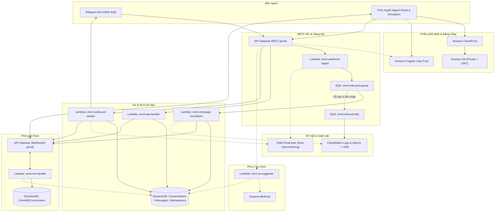

# Kiến trúc Hệ thống Serverless (`architecture.md`)

Backend **OmniInbox** được xây dựng theo hướng **Event-Driven Serverless** trên AWS Region `ap-southeast-1` (Singapore), chạy hoàn toàn trên `AWS Lambda (Node.js 22.x / arm64)` kết hợp `API Gateway`, `SQS`, `DynamoDB` và `SSM Parameter Store`.

---

## 1. Phạm vi hệ thống

- **Kênh thật:** `telegram` (nhận webhook từ Telegram Bot API và phản hồi 2 chiều).
- **Kênh mô phỏng:** `shopee`, `zalo`, `webchat` (do trang Simulator gửi vào endpoint webhook, lưu lịch sử để kiểm thử luồng đa kênh và gắn `deliveredVia: "simulator"`).
- **AI Pha 2 (tùy chọn):** `omni-ai-suggester` gọi Amazon Bedrock Converse API, tách riêng để không ảnh hưởng luồng chính.

---

## 2. Sơ đồ kiến trúc tổng quan

> Lưu ý khi vẽ lại sơ đồ báo cáo: `CloudFront` chỉ phục vụ file tĩnh từ `S3`. Trình duyệt kết nối trực tiếp tới `Cognito`, `API Gateway REST` và `API Gateway WebSocket`.

---

## 3. Ba luồng hoạt động chính

### Luồng 1 — Nhận tin nhắn Inbound và chống trùng
1. Telegram hoặc Simulator gọi `POST /webhook/{channel}`.
2. `omni-webhook-ingest` kiểm tra tên kênh hợp lệ, xác thực Telegram `X-Telegram-Bot-Api-Secret-Token` (đối chiếu với SSM) hoặc kiểm tra cờ `ALLOW_SIMULATOR`, giới hạn kích thước 64KB, đóng dấu `receivedAt` rồi đẩy vào `omni-inbound-queue` và trả `200 QUEUED` ngay.
3. `omni-message-normalizer` nhận batch từ SQS (tối đa 5 tin/lần), chuẩn hóa nội dung (bao gồm caption và media Telegram), khóa chống trùng trên `OmniIdempotency` (`PROCESSING -> DONE`), dùng `TransactWriteItems` để vừa lưu tin nhắn vừa cập nhật hội thoại, rồi đẩy sự kiện `NEW_MESSAGE` qua WebSocket. Nếu lỗi bất kỳ record nào, hàm log dòng bắt đầu bằng `[NORMALIZER_FAILURE]` và trả về `batchItemFailures` để SQS thử lại riêng tin đó.

### Luồng 2 — Nhân viên đăng nhập, tải hội thoại và mở WebSocket
1. Nhân viên đăng nhập qua Amazon Cognito để lấy `ID Token`, gửi kèm trong header `Authorization` cho `GET /conversations`, `GET /messages`, `PATCH /conversations/{id}`.
2. Để kết nối WebSocket, frontend gọi `POST /ws-ticket` xin một mã vé sống 60 giây (lưu trên `OmniIdempotency` kèm `clientType`), rồi mở `wss://.../prod?ticket=<uuid>`.
3. `omni-ws-handler` ở route `$connect` xóa ngay bản ghi vé đó (đảm bảo mỗi vé chỉ dùng 1 lần) và lưu `connectionId` vào `OmniWSConnections`.

### Luồng 3 — Nhân viên gửi phản hồi và khóa tranh quyền 409
1. Frontend gửi `POST /messages/reply` tới `omni-outbound-sender`.
2. Hàm tự lấy `agentId` từ JWT, kiểm tra người phụ trách hội thoại trên DynamoDB: nếu đồng nghiệp khác đã nhận thì trả `409 CONVERSATION_ASSIGNED_TO_OTHER`; nếu đang `unassigned` thì tranh quyền nguyên tử trước khi gọi ra ngoài.
3. Hàm ghi trước tin ở trạng thái `SENDING` trong `OmniMessages`. Với `telegram`, hàm đọc bot token từ SSM và gọi Telegram API (timeout 8 giây, tự làm mới token 1 lần nếu gặp `401`). Với kênh mô phỏng, không gọi HTTP ra ngoài.
4. Gửi xong: cập nhật `SENT` / `FAILED` / `UNKNOWN`. Chỉ khi `SENT` và chưa có tin khách mới đến xen giữa thì mới xóa `unreadCount` và chuyển `OPEN -> IN_PROGRESS`, sau đó đẩy `OUTBOUND_MESSAGE` qua WebSocket.

---

## 4. Một số lựa chọn kỹ thuật chính

- **Tách 5 Lambda lõi + 1 Lambda AI thay vì gộp chung 1 hàm:** Để bám sát nguyên tắc phân quyền tối thiểu của từng IAM Role trên từng dịch vụ (ingest chỉ được đẩy SQS, ws-handler chỉ động vào bảng connection/ticket) và khớp đúng sơ đồ chấm điểm.
- **Chạy Node.js 22.x trên `arm64`:** `Node.js 20.x` bước vào lộ trình ngừng hỗ trợ (30/4/2026); dùng `arm64` giúp tiết kiệm chi phí compute và có sẵn `fetch` + `@aws-sdk/*` v3.
- **Khóa idempotency 2 pha (`PROCESSING` -> `DONE`) và `STALE_LOCK_MS = 20_000`:** Không đánh dấu `DONE` trước khi lưu DynamoDB để tránh mất tin khi lỗi giữa chừng; thời gian khóa 20 giây nằm giữa Lambda timeout (`5s`/`10s`) và SQS visibility (`30s`/`60s`) để worker thử lại không bị kẹt.
- **Tách `clientType` (`portal` / `simulator`) khi broadcast WebSocket:** Giúp điện thoại ở trang Simulator nhận được phản hồi `OUTBOUND_MESSAGE` của kênh mô phỏng, nhưng tuyệt đối không bị lọt tin nhắn thật từ Telegram xuống kết nối của Simulator.
- **Cache tham số SSM 5 phút:** Giảm số lần gọi `ssm:GetParameter` trên mỗi tin nhắn, đồng thời tự `forceRefresh` ngay khi gặp lỗi xác thực (`403`/`401`) để xoay khóa mà không phải deploy lại hàm.
